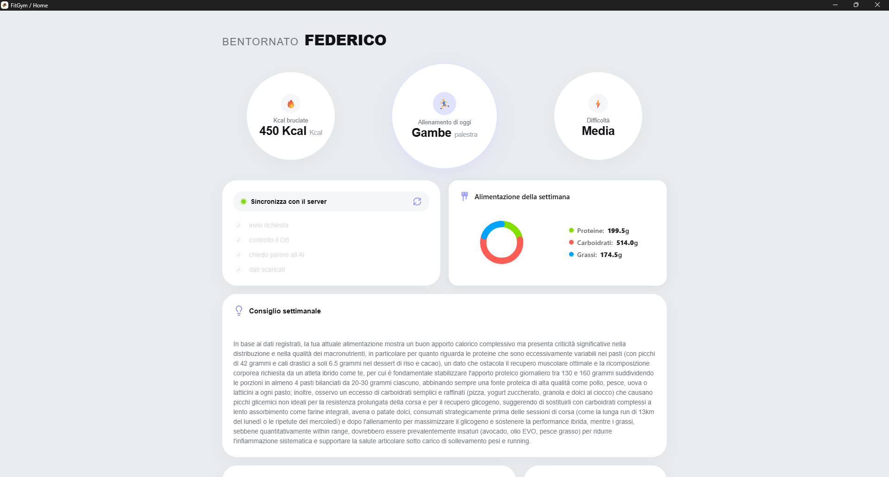
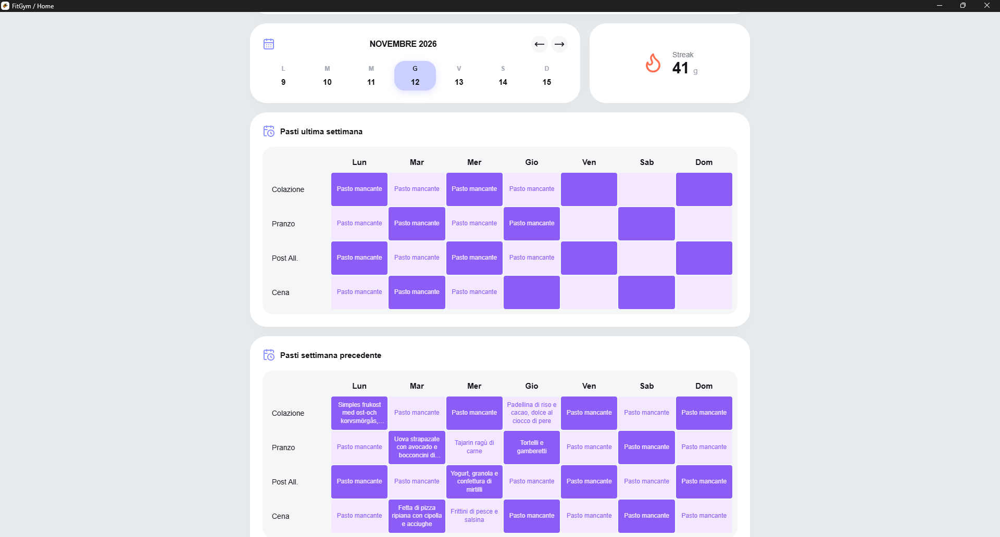

# FitGym

FitGym è un sistema composto da un'applicazione desktop e da un servizio remoto per registrare i pasti tramite Telegram e consultarne i dati in una dashboard. Una foto inviata al bot viene analizzata con Groq, archiviata su Turso e importata nell'applicazione quando si avvia la sincronizzazione.

## Funzionalità

- Invio di una foto del pasto al bot Telegram.
- Analisi dell'immagine e stima dei valori nutrizionali.
- Conservazione dei pasti in un buffer remoto, in attesa della sincronizzazione con l'app.
- Dashboard desktop con pasti della settimana corrente e precedente, riepiloghi nutrizionali e storico settimanale.
- Commento settimanale generato con OpenRouter a partire dai pasti e dal profilo locale.

Alcuni indicatori di allenamento e attività mostrati nell'interfaccia sono attualmente dati predefiniti nel frontend. Le stime nutrizionali e i commenti generati sono indicativi e non sostituiscono il parere di un professionista.

## Architettura e flusso dei dati

1. Il servizio Node.js ospitato su Render mantiene attivo il webhook del bot Telegram.
2. Quando viene inviata una foto, il bot la riceve e recupera il file tramite le API di Telegram.
3. Il server invia l'immagine a Groq, che restituisce una stima del piatto e dei relativi valori nutrizionali.
4. Il server salva il risultato come dato in attesa nel database cloud Turso.
5. Quando l'app desktop avvia la sincronizzazione, richiede al server i pasti in attesa. Il client li salva nel proprio database SQLite locale e aggiorna gli aggregati settimanali.
6. Se la sincronizzazione è stata avviata dall'interfaccia, il client invia a OpenRouter il profilo locale e i pasti recenti e salva il commento settimanale ricevuto.
7. Al termine delle operazioni, il client conferma la sincronizzazione al server, che svuota il buffer remoto.

La sincronizzazione con il server remoto avviene anche all'avvio dell'app. L'analisi settimanale con OpenRouter viene invece richiesta quando si avvia la sincronizzazione dall'interfaccia.

### Dati nutrizionali

Nel codice attuale, la risposta dell'analisi Groq comprende il nome del piatto, calorie, proteine, carboidrati e grassi.

## Tecnologie

### Applicazione desktop

- Electron per la finestra desktop e il processo principale.
- Node.js e JavaScript con moduli ES.
- HTML, CSS e JavaScript senza framework frontend.
- Electron IPC per la comunicazione tra interfaccia e processo principale, tramite preload; `contextIsolation` è attivo e `nodeIntegration` è disattivato.
- SQLite con `better-sqlite3` per i pasti importati e i riepiloghi locali.
- OpenRouter per il commento nutrizionale settimanale.

### Servizio remoto

- Node.js, Express e Telegraf per il server HTTP, il webhook e l'integrazione con Telegram.
- Groq per l'analisi delle immagini dei pasti.
- Turso, tramite `@libsql/client`, per il buffer cloud dei pasti in attesa di sincronizzazione.
- `dotenv` per la configurazione delle variabili d'ambiente.

## Schermate

